# RiskFlow — Credit Risk & Fraud Analytics

A local analyst workspace that turns synthetic financial records into separate credit assessments and transaction alerts, explains the evidence, records review decisions, and produces Excel reporting feeds.

**Python · SQL · SQLite / MySQL · Excel · optional OpenAI / Ollama**

[](https://github.com/DaniyalHayat/riskflow-credit-fraud/actions/workflows/tests.yml)
[](https://www.python.org/downloads/)
[](LICENSE)

[Open the Excel workbook](excel/RiskFlow_Analytics.xlsx) · [Architecture](docs/ARCHITECTURE.md) · [Product requirements](docs/PRODUCT_REQUIREMENTS.md) · [Five-minute demo](docs/DEMO_WALKTHROUGH.md)

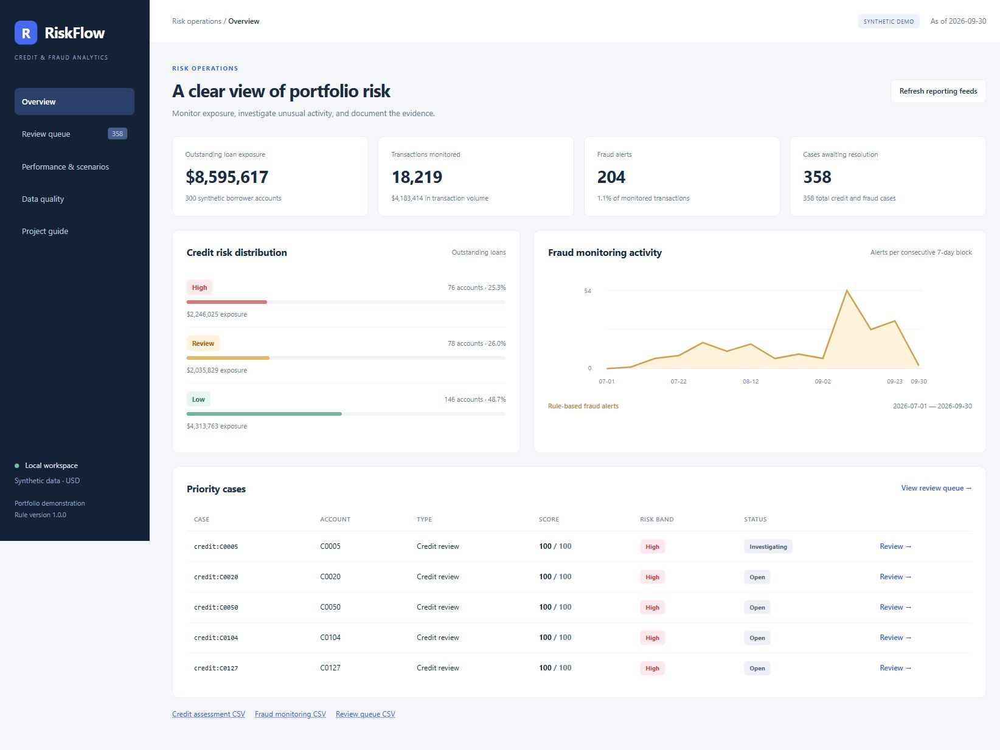

## Visual walkthrough

The screenshots below come from the running local application and the delivered Excel workbook. All customers, financial records, labels and review examples are synthetic. Open a section to inspect the workflow; click an image to view it at full size.

### Analyst workspace

The overview above connects four distinct measures: outstanding loan exposure, transaction volume, fraud alerts, and unresolved credit/fraud cases. Credit-band exposure is an as-of snapshot; the activity chart shows transaction alerts over time. The priority table opens the underlying review cases.

<details>
<summary><strong>Review queue — search, separate risk types, filter status, and prioritize work</strong></summary>

Search by account/case ID, filter credit reviews separately from fraud monitoring, and narrow the queue by disposition. Scores determine review priority. Pagination keeps a large case list usable.

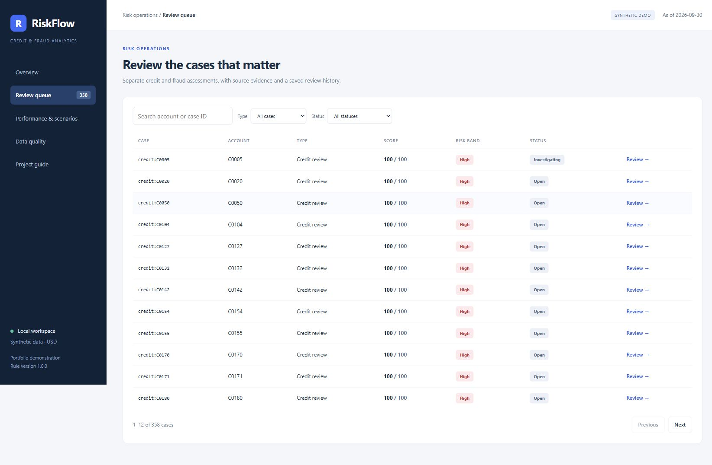

</details>

<details>
<summary><strong>Credit case — explain the score and document the analyst's decision</strong></summary>

Each evidence card shows an observed financial indicator, its configured trigger and its point contribution. The review form captures the analyst, status and reasoning. History retains prior decisions rather than replacing them.

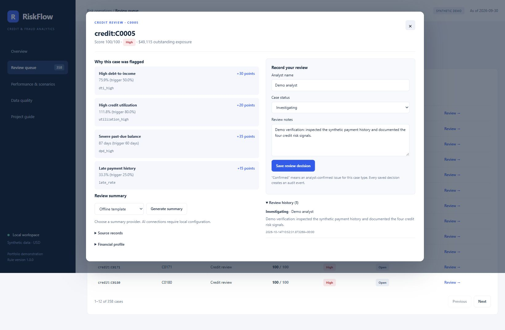

The source sections expose historical installments and the account's financial profile. Currency is displayed in USD; integer cents remain the storage contract. This lets a reviewer distinguish current unpaid delinquency from installments that were paid late.

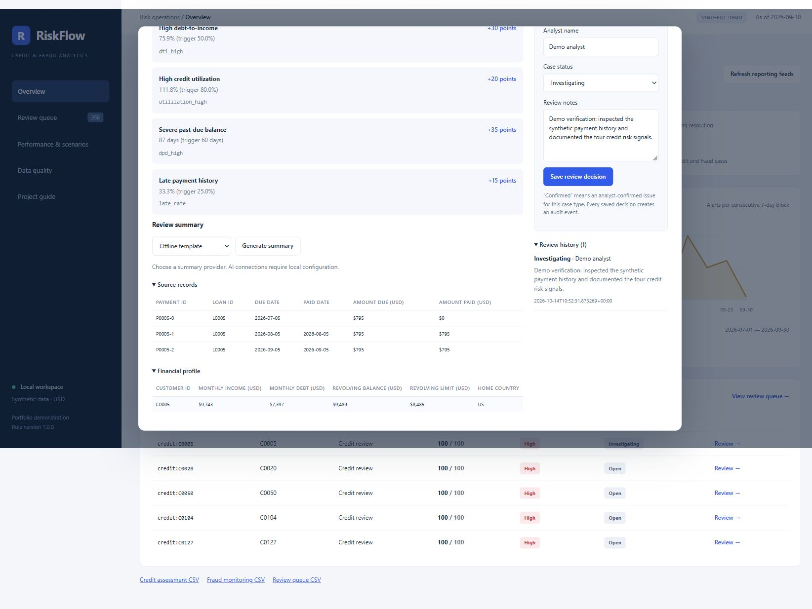

</details>

<details>
<summary><strong>Review explanation — evidence-linked summary with an explicit offline mode</strong></summary>

The example uses the offline template and is labeled **no AI**. The same control offers configured OpenAI or local Ollama providers. Generated explanations cite the existing signal IDs and suggest review steps; they cannot change a score or approve/deny a loan.

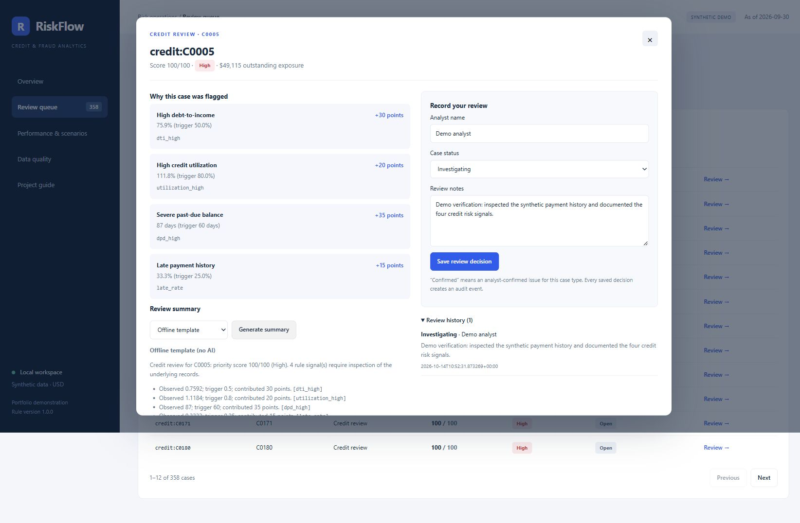

</details>

<details>
<summary><strong>Fraud case — compare a transaction with its prior activity</strong></summary>

This synthetic example combines an amount spike, rapid activity and repeated payments. The three contributions total an 85/100 review-priority score. A flag means the transaction warrants investigation; it is not a finding of proven fraud.

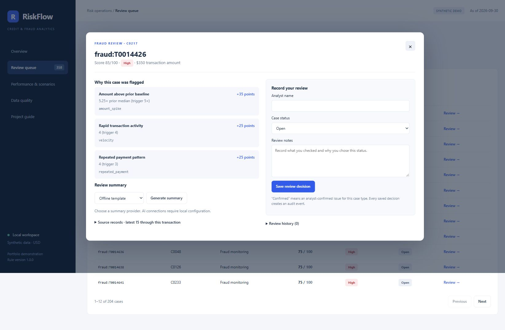

The expanded records show recent activity through the scored transaction. The rolling baseline and the source view exclude later observations, including later IDs at the same timestamp.

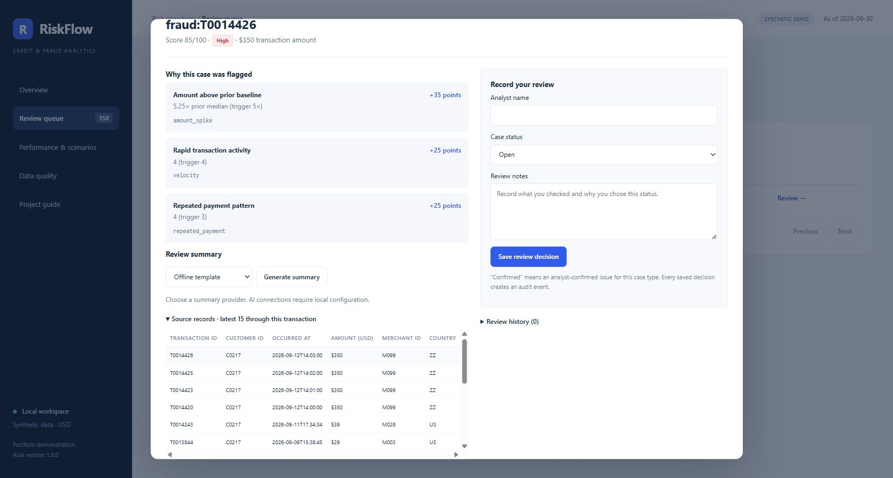

</details>

<details>
<summary><strong>Performance and scenarios — inspect detection/workload tradeoffs</strong></summary>

The benchmark reports precision, recall, false-positive rate and alert rate against synthetic labels. Independent credit/fraud sliders preview how many records and how much exposure/transaction volume cross a chosen cutoff. Scenario previews do not overwrite saved rules or case decisions.

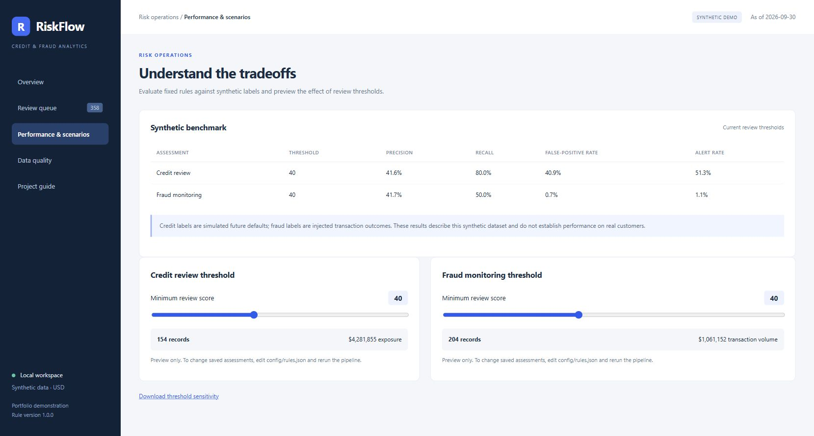

The alternative cutoff example illustrates the change in credit review volume at a score of 100 while keeping the fraud cutoff at 40.

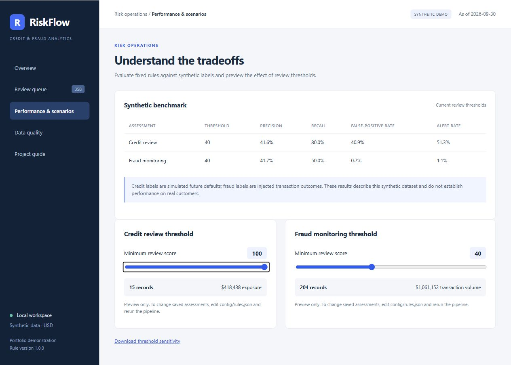

</details>

<details>
<summary><strong>Data quality — trace accepted/rejected rows and batch lineage</strong></summary>

The source table reconciles input, accepted and rejected record counts. Five intentionally invalid transactions exercise the quarantine path. Run IDs, source/rule hashes and local runtime make the batch inspectable. Accepted transaction counts and integer-cent totals are reconciled before commit.

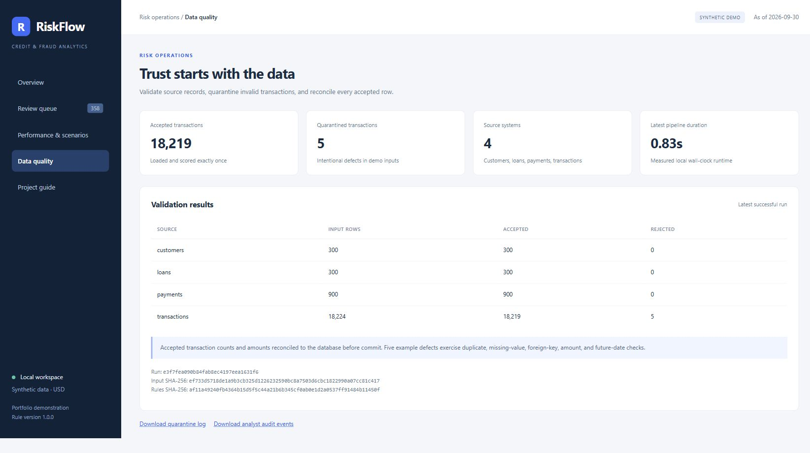

</details>

<details>
<summary><strong>Project guide — explain the pipeline, AI role and reporting workflow</strong></summary>

The in-app guide explains the sequence from synthetic inputs to analyst review and Excel reporting. It also states the limits of the heuristic scores, AI explanations, revision-aware reviews and local demonstration server.

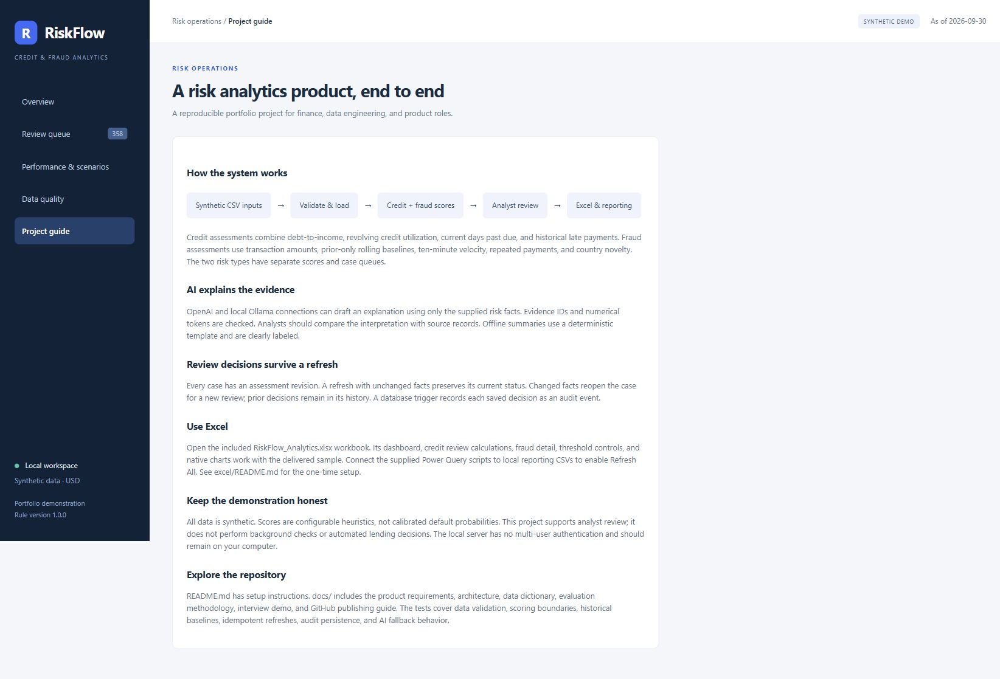

</details>

### Excel workbook — all seven sheets

[Download/open RiskFlow_Analytics.xlsx](excel/RiskFlow_Analytics.xlsx). These are rendered worksheet previews of the supplied workbook. Dashboard and Controls show their complete working sections; long record tables show readable sample rows rather than thousands of rows compressed into one image. Every source record remains available in the workbook.

| Sheet | What it demonstrates |
|---|---|
| Dashboard | Formula-linked portfolio exposure, review volumes, credit distribution and monthly monitoring charts |
| Controls | Editable review thresholds, credit signal triggers and scoring weights |
| Credit Review | DTI/utilization calculations, visible rule contributions and calculated credit bands |
| Credit Source | Financial inputs and saved pipeline scores for all 300 accounts |
| Fraud Detail | All 18,219 transaction assessments, prior baselines, velocity/repeats and risk scores |
| Daily Source | Daily transaction totals, alert counts/rates and the month key used by reporting |
| Review Queue | A reporting snapshot of case IDs, priorities, statuses, analysts and notes |

<details>
<summary><strong>1. Dashboard — portfolio and monitoring outputs</strong></summary>

The main view links to the calculated credit review and source tables. It separates loan exposure from transaction activity, counts records above the selected thresholds, and shows exposure by credit band plus monthly fraud-alert totals.

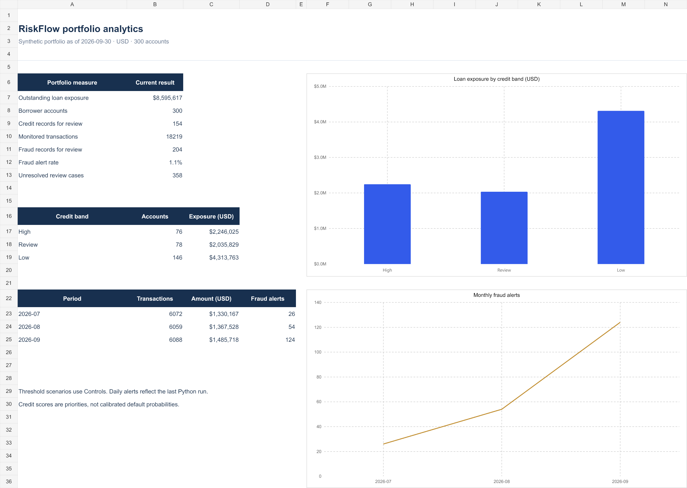

</details>

<details>
<summary><strong>2. Controls — editable thresholds and weights</strong></summary>

Amber cells identify editable controls. Credit trigger levels and weights feed the Credit Review formulas. Credit/fraud review cutoffs change workbook scenario counts. These cells do not rewrite Python configuration or recompute historical fraud features; saved pipeline bands remain a separate reference.

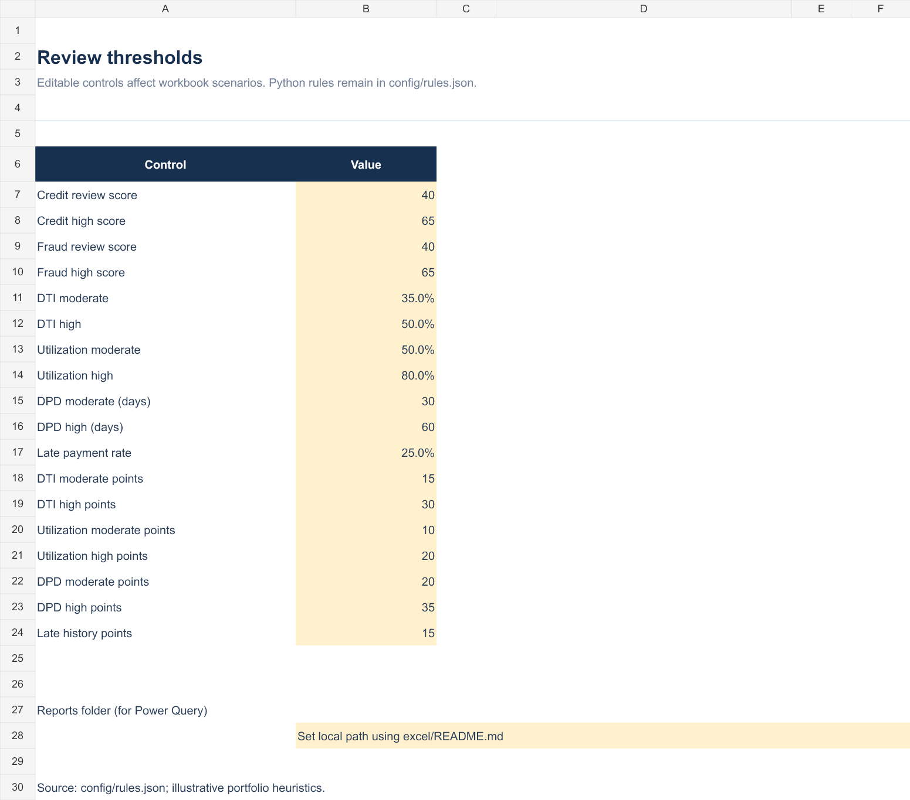

</details>

<details>
<summary><strong>3. Credit Review — traceable calculations and score contributions</strong></summary>

DTI equals total monthly debt obligations divided by monthly income. Utilization equals revolving balance divided by its limit. The build then exposes DTI, utilization, delinquency and late-history point contributions, caps their sum at 100, and assigns the configured band. At default controls, all 300 calculated scores match Python.

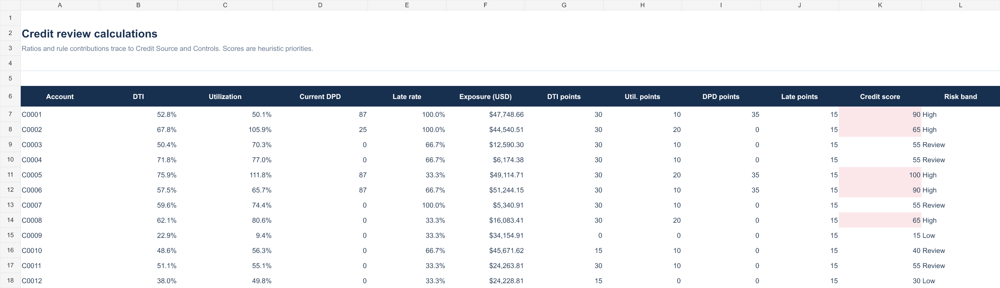

</details>

<details>
<summary><strong>4. Credit Source — account inputs and pipeline reference values</strong></summary>

This filterable input table contains monthly income/debt, revolving balance/limit, delinquency, late history and outstanding loan exposure. Saved pipeline scores/bands allow comparison with workbook scenarios. The preview shows the first 13 of 300 synthetic accounts.

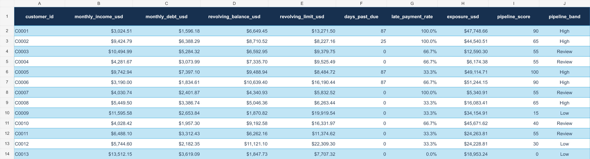

</details>

<details>
<summary><strong>5. Fraud Detail — transaction assessment features and flagged examples</strong></summary>

Each row is one scored transaction. Amount/baseline ratios, ten-minute counts, repeated-payment counts and the final score are separate fields. Early rows legitimately have blank baselines because fewer than ten prior observations are available; a missing baseline is not replaced with zero.

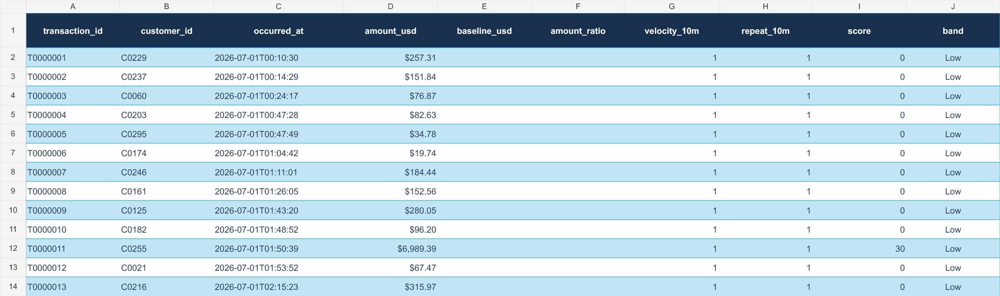

The second view shows the synthetic burst around transaction T0014426, including its 85-point assessment and surrounding observations. It demonstrates how the feature values change as a repeated-payment sequence develops.

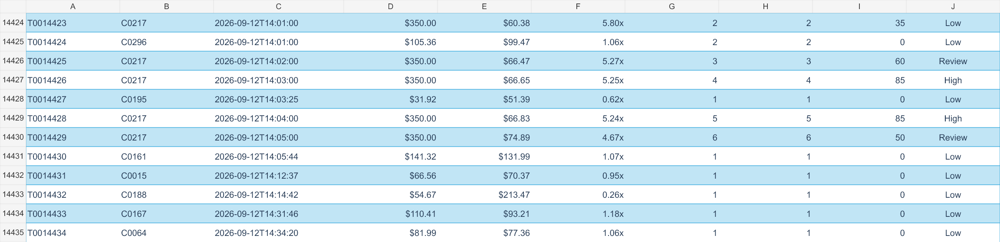

</details>

<details>
<summary><strong>6. Daily Source — the grain behind monitoring trends</strong></summary>

Daily transaction counts, USD volume, fraud alerts and alert rates feed the monthly dashboard. The explicit month key keeps aggregation transparent. This is transaction activity history, not a time series of loan exposure.

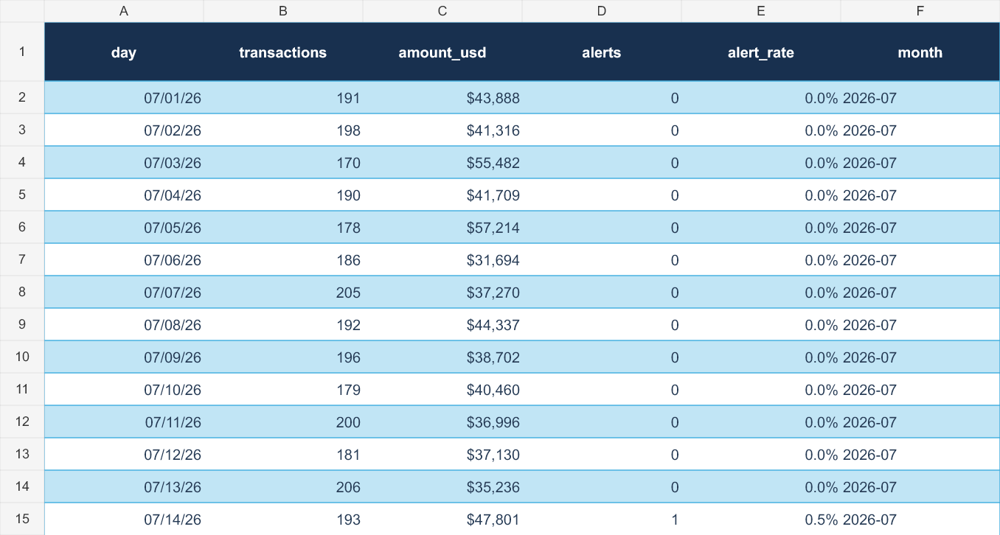

</details>

<details>
<summary><strong>7. Review Queue — analyst workflow in the reporting layer</strong></summary>

The exported queue contains case ID/type, account, score, band, associated amount, status, analyst and notes. It is a snapshot for reporting; decisions are recorded in the web application and pulled into Excel after export/refresh. This baseline shows cases before new analyst decisions.

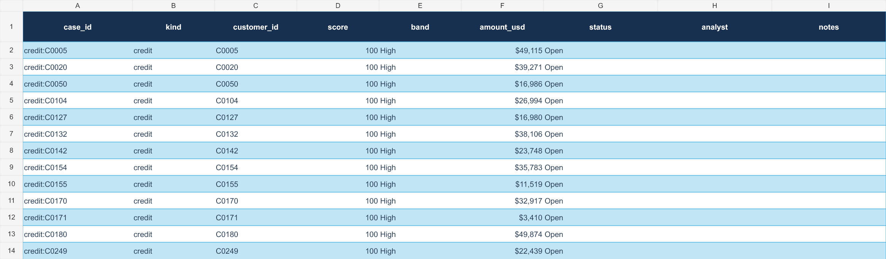

</details>

Power Query connections and a native credit-exposure PivotTable are added by the supplied Windows Excel helper after local setup. See [Excel refresh instructions](excel/README.md) for the connection workflow and its verification limits.

## Start here

1. Download and extract the complete project folder.
2. Install **Python 3.11 or later** from [python.org](https://www.python.org/downloads/). On Windows, enable **Add Python to PATH**.
3. On Windows, double-click **start_windows.cmd**. A terminal starts the pipeline and dashboard. If the browser opens before the server is ready, refresh the page.
4. Open **http://127.0.0.1:8000** in your browser. Keep the terminal open; press Ctrl+C to stop.
5. Open **excel/RiskFlow_Analytics.xlsx** for the populated workbook. No AI account, database server, or pip installation is needed for the default demo.

On macOS or Linux, open a terminal in this folder and run `sh start_mac_linux.sh`.

### Run manually

```powershell
python -m riskflow demo
python -m riskflow serve
```

Windows users can substitute `py -3` for `python`. macOS/Linux users can substitute `python3`.

## What is implemented

| Area | Delivered behavior |
|---|---|
| Data engineering | Seeded CSV generator, strict input contracts, transaction quarantine, integer-cent accounting, indexed relational tables, atomic refresh, row/amount reconciliation, input and rules hashes |
| Credit review | DTI, utilization, current days past due, late-payment history, outstanding exposure, weighted score contributions |
| Fraud monitoring | Prior-only 30-day median baseline, amount spikes, 10-minute velocity/repeats, country novelty, configurable scores |
| Analyst product | Separate queues, search/filter/pagination, source inspection, case statuses, revision-aware decisions, append-only history, trigger-generated audit events |
| AI | Optional Responses API and local Ollama adapters, structured explanations, evidence checks, numerical checks, visible offline fallback |
| Excel | Populated workbook, formulas, adjustable thresholds, charts, filterable tables, reporting feeds, Power Query scripts and a Windows connection helper |
| Measurement | Synthetic confusion matrices, precision/recall/false-positive rates, threshold sensitivity, measured pipeline runtime |
| Portfolio documentation | PRD, architecture, data dictionary, methodology, demo walkthrough, role-specific resume language and GitHub publishing guide |

## Reproduce the included benchmark

Default: **seed 42; 300 accounts; as of September 30, 2026**.

| Metric | Credit review | Fraud monitoring |
|---|---:|---:|
| Scored records | 300 | 18,219 |
| Records above review threshold 40 | 154 | 204 |
| Precision | 41.6% | 41.7% |
| Recall | 80.0% | 50.0% |
| False-positive rate | 40.9% | 0.66% |

Five invalid transactions are quarantined. These are descriptive results on **synthetic** data, not evidence of real-world fraud prevention or lending performance. Credit scores are heuristic review priorities, not calibrated default probabilities. See [evaluation methodology](docs/EVALUATION.md).

## Commands

```powershell
python -m riskflow generate --customers 300 --seed 42
python -m riskflow pipeline
python -m riskflow evaluate
python -m riskflow export
python -m riskflow summary
python -m unittest discover -s tests -v
```

`demo` runs generate, pipeline, evaluate, and export in order. `pipeline` refreshes the database using existing CSVs. `export` updates CSV reporting feeds after analyst decisions. `generate` replaces the generated synthetic inputs; it does not delete review history. Decisions apply to an exact input/rules/assessment revision. Changing the input snapshot or rules requires new reviews, while prior history remains available.

The delivered Excel workbook contains the 300-account baseline. The optional Excel refresh helper adjusts calculation rows and reporting ranges when the exported dataset changes. Review dashboard charts after refresh.

## Enable AI explanations

### OpenAI

Copy `.env.example` to `.env`. Fill in `OPENAI_API_KEY` and `OPENAI_MODEL` with a Structured Outputs-compatible model available to your API account. Model selection is explicit; the project does not assume account access to a particular model.

```powershell
python -m riskflow summary --provider openai --case credit:C0005
```

Alternatively, choose **OpenAI** in a case's summary menu. Only synthetic scored facts are sent, when you click Generate summary. Review notes, future evaluation labels, and API keys are not included in the prompt. The API request uses `store: false`. API usage may incur charges; a ChatGPT subscription is separate from API billing. Keep `.env` out of GitHub.

### Local Ollama

Install [Ollama](https://ollama.com/), run `ollama pull llama3.2`, and ensure its local service is running. Set `OLLAMA_MODEL` if you use another installed model. Select **Local Ollama** in the dashboard or run:

```powershell
python -m riskflow summary --provider ollama
```

AI output is checked for valid evidence references, supported next steps and supplied numerical tokens. This does not prove that every sentence is factually sound. Connection failures, refusals and invalid responses visibly fall back to the offline template. The offline template is not represented as AI.

## Use MySQL

The default runs on SQLite to make the project immediately usable. The **same application** supports MySQL 8.4 with a schema, indexes, reporting views, and a native review-audit trigger.

```powershell
Copy-Item .env.example .env
# Set the demo passwords in .env and DB_BACKEND=mysql.
docker compose up -d mysql
python -m pip install -r requirements-mysql.txt
python -m riskflow demo --backend mysql
python -m riskflow serve --backend mysql
```

Wait until `docker compose ps` reports the database healthy. If Docker is unavailable, connect to an existing local MySQL 8.4 server and create the `riskflow` database/user with permission to create tables, views, indexes and triggers. Details: [MySQL setup](docs/MYSQL.md).

## Repository map

```text
riskflow/          Pipeline, scores, DB adapter, reviews, AI, server, CLI
config/            Versioned rule thresholds and weights
sql/               SQLite/MySQL schemas and analyst SQL examples
web/               Dashboard HTML, CSS and JavaScript
data/raw/          Reproducible synthetic CSVs and evaluation-only labels
reports/           Generated benchmark, reporting CSVs and QA evidence
excel/             Populated workbook, Power Query scripts, refresh helper
docs/              Product/design/methodology/demo/GitHub guides
tests/             Unit and integration tests
.github/workflows/  Windows/Linux core checks and live MySQL CI job
```

## Project boundaries and verification

The project implements a complete **local portfolio demonstration**. It does not include background checks, automated credit approval, a calibrated credit model, bank integrations, production authentication, or a deployed cloud service. The synthetic generator makes both normal anomalies and subtle injected fraud, so the rules visibly miss cases and generate false positives.

See [verification report](docs/VERIFICATION.md) for what was actually run, what used mocked API responses, and which integrations need verification on your machine. The local HTTP server binds to loopback and should stay local.

## Put it on GitHub

Follow [the step-by-step GitHub guide](docs/GITHUB_GUIDE.md). Publish the **extracted project contents**, not just the ZIP. The included `.gitignore` excludes keys, local databases, virtual environments and generated AI summaries.

## References

- [OpenAI Structured Outputs](https://developers.openai.com/api/docs/guides/structured-outputs): optional structured explanation contract.
- [MySQL Connector/Python connection documentation](https://dev.mysql.com/doc/connector-python/en/connector-python-example-connecting.html): optional database adapter.
- [GitHub's import guide](https://docs.github.com/en/migrations/importing-source-code/using-the-command-line-to-import-source-code/adding-locally-hosted-code-to-github): publication workflow.

## License

MIT. All included customer and transaction data is synthetic.
