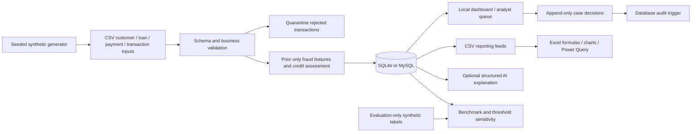

# Architecture and design decisions

I organized RiskFlow around a reproducible batch pipeline, an inspectable review workflow, and a separate reporting layer. I chose transparent rules and relational controls so the path from source records to an analyst decision remains visible.

## Processing and storage

The generator is deterministic for a seed, account count and as-of date. Transactions are processed in chronological order with a stable ID tie-breaker. Customer/loan attributes are explicitly synthetic snapshots at the as-of date.

CSV validation precedes publication. Invalid transactions are quarantined, while invalid credit source rows stop publication to avoid incomplete account assessments. Scoring occurs in Python over validated data, with business weights owned by `config/rules.json`. SQL owns relational integrity, indexes, summaries and the case audit trigger.

The batch deletes and replaces current observation/assessment/case tables **inside one transaction**. Reviews, audit events and run history survive. Before commit, counts and integer-cent transaction totals must match accepted source controls. A database exception rolls back the refresh. CSV report exports occur after commit; if a report-file write fails, rerun `export` and check the successful batch record. Database publication and filesystem reports are not a distributed transaction.

## Time correctness

Fraud baselines use only records before the current scored transaction in the prior 30 days. The current transaction is appended after scoring. The 10-minute activity window is inclusive of the exact lower time boundary and includes the current transaction in its count. Equal timestamps are ordered by transaction ID.

Credit days past due describe unpaid/partly unpaid obligations as of the snapshot. Fully repaid but late installments contribute to late history, not current days past due. Historical installments and synthetic future-default outcomes live in different files/processing paths. Labels are never loaded into serving tables or supplied to AI.

## Cases and revisions

Case IDs are stable (`credit:C0005`, `fraud:T0000123`). The revision hashes the calculated facts, evidence, configuration hash and full input-snapshot hash. An exact replay retains the current decision. **Any input snapshot or rules change invalidates all current case revisions**, a conservative batch-level policy. Previous decisions remain visible, and disappeared cases still retain database history.

SQLite uses `BEGIN IMMEDIATE` and MySQL uses a case row lock during a decision. Saving a decision checks the submitted revision. Timestamps are advanced monotonically per case when the clock returns equal values. The database trigger records the audit event in the same transaction as the decision.

## AI contract

The adapter passes synthetic case ID, risk type, score, band, evidence and allowed next steps. It requests structured JSON, checks the returned structure/references/numerical tokens and records the requested/actual provider. On failure, it explicitly returns an offline template with a warning. No semantic verifier proves every generated interpretation; an analyst must inspect it.

## Local serving

Standard-library HTTP server, HTML/CSS/JavaScript, and separate database connections per request. Loopback binding, Host/Origin checks, session CSRF token, limited request sizes, parameterized values, output escaping, restrictive script CSP and export allowlists protect the local demonstration from routine cross-origin and injection mistakes. These are not substitutes for production authentication, authorization or hardening.

## Reproducibility

Run records store the UTC runtime timestamp, fixed business as-of date, source/rule SHA-256 hashes, duration and validation statistics. The generated sources and report snapshots are deliberately included in the repository; runtime databases and credentials are excluded.
